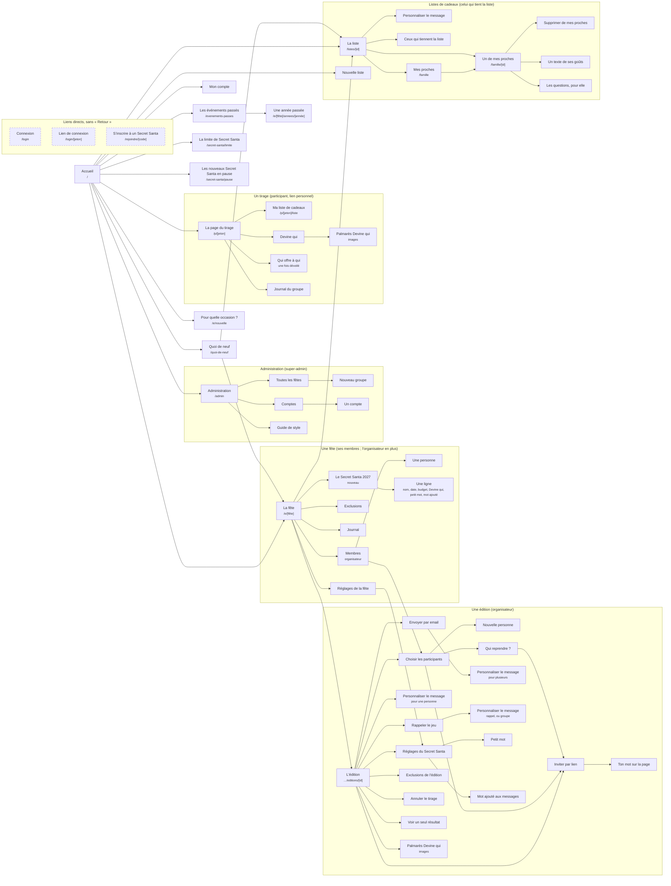

# Arborescence des écrans

Ce fichier décrit l'arbre des pages de l'application : qui est le parent de qui, et donc où mène « Retour ». **À tenir à jour à chaque nouvel écran** : une ligne dans le bon tableau, avec son parent, et le `back` de la page qui le dit dans le code.

## Vue d'ensemble

Chaque flèche va d'un écran vers ses enfants ; « Retour » la remonte. Les écrans en pointillés n'ont pas de « Retour » : on y arrive par un lien. Le schéma s'affiche sur GitHub et dans l'aperçu Markdown de VS Code ; les tableaux plus bas donnent les adresses et les panneaux.

## La règle du bouton « Retour »

Décidée par Julien le 18 novembre 2026.

- « Retour » remonte d'un cran dans cet arbre, vers le **parent logique** de l'écran. Ce n'est pas le retour du navigateur : un écran ouvert depuis l'accueil, un email ou un lien partagé remonte quand même à son parent.
- Chaque page déclare son parent dans `back` (`AdminScreen`, `ParticipantScreen`), et les actions qui ramènent après un enregistrement (« Valider », « Enregistrer ») vont au même parent.
- `useGoBack` (`app/composables/useGoBack.ts`) applique la règle avec `backMove` (`shared/utils/navigation.ts`, testé) : si la page précédente de l'historique est justement ce parent, le navigateur revient en arrière, pour ne pas empiler deux fois la même page ; sinon le parent s'ouvre.
- Les panneaux du bas (`UiSheet`) ne sont pas des écrans : ils se ferment, ils ne remontent pas. Ils sont indiqués sous l'écran qui les ouvre.
- Le retour du navigateur, lui, garde son comportement habituel.

### Quand une page a plusieurs parents

Ajouté le 21 novembre 2026 (`docs/spec/v3/navigation.md`, ticket 114). Une liste, un événement, ma page d'un Secret Santa, celle de l'organisateur, « Mes proches », la fiche d'un proche et une année passée se montrent à plusieurs endroits : « Retour » mène à **celui d'où je viens**, si c'est l'un de leurs parents (le tableau de `navigation.md`), sinon au parent par défaut (un email, un lien, une adresse tapée, la page rechargée).

- `parentOf` et `PARENTS` (`shared/utils/navigation.ts`, testés ligne par ligne) disent, pour la page d'avant dans l'historique, si elle est un parent ; `useParent` (`app/composables/useParent.ts`) la lit une fois la page montrée.
- Le parent d'où je viens est retenu pour la visite : revenu d'une page fille (ses teneurs, la fiche d'un proche, un réglage), « Retour » y mène encore. Un rechargement l'oublie. Rien ne vient de l'adresse : « Retour » n'ouvre qu'une page que je viens de voir.
- Un geste qui ferme la page (supprimer une liste, cesser de la tenir) mène là où « Retour » aurait mené depuis elle (`useParentOfPage`).
- Sans session, ma page d'un Secret Santa et une liste par son lien n'ont pas de « Retour ».

## Accueil et compte

| Écran | Adresse | Parent (« Retour ») | Panneaux |
|---|---|---|---|
La barre du bas (« Accueil », « Créer », « Quoi de neuf », et « Admin » pour le super-admin) est sur chaque écran de qui est connecté : « Quoi de neuf » et « Admin » s'allument sur leurs pages, toute autre page est sous « Accueil » (`tabOf`). « Créer » ouvre son panneau. « Une liste » change le panneau en son « Pour quelle occasion ? » (ticket 106) : un de mes événements crée la liste pour lui et l'ouvre (`/listes/[id]`) ; « Une autre occasion », ou aucun événement à moi, mène à `/e/nouvelle?pour=liste`, qui crée l'événement puis la liste. « Un Secret Santa » change le panneau en son « Pour quelle occasion ? » (ticket 105) : une fête que j'organise mène au formulaire (`/admin/[fête]/editions/nouvelle`), « Une autre occasion » à `/e/nouvelle?pour=secret-santa`. Sans fête à moi, il mène droit à `/e/nouvelle?pour=secret-santa` ; à ma limite, à `/secret-santa/limite` ; quand le super-admin a suspendu les nouveaux Secret Santa, à `/secret-santa/pause` (ticket 109). Le menu du compte s'ouvre sur mon icône, en haut à droite de chaque écran : « Mon compte », « Langue » (panneau du bas), « Se déconnecter ».

| Accueil, ou connexion sans session | `/` | — (barre du bas) | |

L'accueil (ticket 103) : l'en-tête d'une carte ouvre la fête (`/e/[fête]`) ; ses lignes ouvrent le Secret Santa (ma page par mon lien, sinon l'édition pour l'organisateur) et les listes (la mienne, celle d'un autre par son lien) ; la ligne « Devine qui » (ticket 112), sous un Secret Santa où le jeu est ouvert, ouvre `/p/[jeton]/devine`, ou `/p/[jeton]/devine/palmares` une fois le palmarès sorti ; « Nouvelle liste » ouvre `/listes/nouvelle?pour=[événement]`, qui crée la liste pour cet événement. « Préparer », dans « Bientôt », ouvre `/e/nouvelle?categorie=birthday&proche=[id]`. Deux mois avant un événement qui revient (ticket 108) : « Préparer Noël 2027 », pour son organisateur, recrée sur place les Secret Santa de l'an dernier (la carte les montre aussitôt) ; « Reprendre ma liste de l'an dernier » ouvre `/listes/nouvelle?pour=[événement]&reprendre=[liste]`, qui crée la liste de l'année et l'ouvre. En bas, « Les événements passés », montrée dès qu'il y en a un, ouvre `/evenements-passes`, et « Ce que j'offre ailleurs », montrée seulement quand j'offre quelque chose sur une liste publique (même sans aucun événement), ouvre `/offert-ailleurs`. Sans aucune fête, les deux cartes ouvrent « Pour quelle occasion ? ».
| Quoi de neuf | `/quoi-de-neuf` | — (barre du bas) | |

« Quoi de neuf » (ticket 120) : chaque ligne ouvre la chose qu'elle signale : ma page d'un Secret Santa (`/p/[jeton]`), le palmarès (`/p/[jeton]/devine/palmares`), le suivi de l'organisateur (`/admin/[fête]/editions/[id]`), les membres d'un événement (`/e/[fête]/membres`), une liste (`/listes/[id]` si je la tiens ou si l'on m'invite à la tenir, sinon `/l/[jeton]`).
| La limite de Secret Santa | `/secret-santa/limite` | Accueil | |
| Les nouveaux Secret Santa en pause | `/secret-santa/pause` | Accueil | |
| Connexion | `/login` | — | |
| Le lien de connexion | `/login/[jeton]` | — | |
| Mon compte | `/compte` | Accueil | Prénom, nom, langue des emails, icône |
| Les événements passés | `/evenements-passes` | Accueil | |
| (ancienne adresse) | `/tirages-passes` | mène aux Événements passés (`pastPathOf`) | |
| (ancienne adresse) | `/listes` | mène à l'accueil (`listsPathOf`, ticket 114) | |
| S'inscrire à un Secret Santa (son lien d'invitation, ticket 116) | `/rejoindre/[code]` | — | |

## Administration (super-admin)

| Écran | Adresse | Parent | Panneaux |
|---|---|---|---|
| Administration | `/admin` | Accueil | « Suspendre les nouveaux Secret Santa » |
| Toutes les fêtes | `/admin/groupes` | Administration | |
| Nouveau groupe | `/admin/groupes/nouveau` | Tous les groupes (super-admin), sinon Accueil | |
| Comptes | `/admin/comptes` | Administration ; les comptes désactivés : Comptes | |
| Un compte | `/admin/comptes/[id]` | Comptes | Limite de Secret Santa, désactivation |
| Guide de style | `/admin/guide-de-style` | Administration | |

## Une fête (ses membres ; l'organisateur pour le reste)

Les anciennes adresses du groupe (`/admin/[groupe]`, `…/personnes`, `…/reglages`, `…/organisateurs`, `…/exclusions`, `…/journal`) mènent à celles de l’événement ; `…/invitation` mène à ses Membres, un événement n'ayant plus de lien d'invitation (ticket 116), comme `/e/[fête]/membres/nouvelle`, personne ne s'ajoutant plus à un événement lui-même (ticket 117), et `/f/…` (l’adresse d’avant le ticket 102) à `/e/…` (`partyPathOf`, `app/middleware/redirects.global.ts`). Les Secret Santa restent sous `/admin/[fête]/editions`.

| Écran | Adresse | Parent | Panneaux |
|---|---|---|---|
| Pour quelle occasion ? (« Continuer » crée l'événement, puis mène au Secret Santa ou à la liste ; plus d'étape « membres », ticket 117) | `/e/nouvelle` | Accueil | |
| La fête | `/e/[fête]` | Accueil ; « Quoi de neuf » quand on en vient | Quitter cette fête (puis l'accueil) |
| Une année passée (lecture seule ; ses lignes ouvrent ma page du Secret Santa ou l'édition, le palmarès, les listes) | `/e/[fête]/annees/[année]` | D'où l'on vient : Les événements passés ou la fête ; sinon la fête si l'adresse le dit (`?depuis=evenement`, ses « Années passées »), sinon Les événements passés | |
| Membres (« Ajouter quelqu'un » : « Au Secret Santa » ouvre Choisir les participants, ou Inviter par lien quand l'événement est complet ; « À ma liste » ouvre Inviter quelqu'un de la liste ; ticket 117) | `/e/[fête]/membres` | La fête | |
| Une personne | `/e/[fête]/membres/[id]` | Membres | Mon icône, exclusion |
| (ancienne adresse) | `/e/[fête]/membres/nouvelle` | mène à Membres (`invitationPathOf`, ticket 117) | |
| (ancienne adresse) | `/e/[fête]/invitation` et `/e/[fête]/invitation/mot` (le lien était à l'événement) | mènent à Membres (`invitationPathOf`, ticket 116) | |
| Exclusions | `/e/[fête]/exclusions` | Membres | Ajouter une exclusion |
| Journal | `/e/[fête]/journal` | La fête | À quoi sert-il ?, une alerte |
| Réglages de la fête | `/e/[fête]/reglages` | La fête | Catégorie, date, organisateur, suppression de la fête |
| (ancienne adresse) | `/e/[fête]/organisateurs` | mène aux Réglages de la fête | |

## Une édition (organisateur)

| Écran | Adresse | Parent | Panneaux |
|---|---|---|---|
| Un nouveau Secret Santa (« Le Secret Santa 2027 ») | `/admin/[fête]/editions/nouvelle` | La fête | |
| Une ligne du nouveau Secret Santa (gardée dans le formulaire, `useNewEditionDraft`) | `…/editions/nouvelle/[nom, date, budget, devine, mot, message]` | Le nouveau Secret Santa | |
| L'édition (Préparer, Réponses, Tirage fait, Fêter, Clôturée) | `/admin/[groupe]/editions/[id]` | La fête ; l'accueil ou « Quoi de neuf » quand on en vient | Lancer le tirage, Le tirage a déjà été fait ?, Valider le tirage, Un souci ?, Envoi à une personne, Dévoiler, Date de la fête, Devine qui |
| Choisir les participants | `…/editions/[id]/ajouter` | L'édition | |
| Nouvelle personne (elle rejoint l'événement et ce Secret Santa, ticket 117) | `…/editions/[id]/nouvelle-personne` | Choisir les participants | |
| Qui reprendre ? (ceux d'un autre événement que j'organise, ticket 117) | `…/editions/[id]/reprendre` | Choisir les participants | |
| Inviter par lien (le lien de ce Secret Santa, ticket 116 ; ouvert depuis « Préparer » sans participant et depuis « Choisir les participants ») | `…/editions/[id]/invitation` | L'édition | Places restantes, date limite |
| Ton mot sur la page | `…/editions/[id]/invitation/mot` | Inviter par lien | |
| Envoyer par email | `…/editions/[id]/emails` | L'édition | |
| Rappeler le jeu (À chacun, par email ; Au groupe) | `…/editions/[id]/rappel` (`?vers=groupe`) | L'édition | |
| Personnaliser le message | `…/editions/[id]/message?pour=` | L'édition, panneau d'envoi rouvert (`?envoyer=`) pour une personne ; Envoyer par email pour plusieurs ; Rappeler le jeu pour `rappel` et `groupe` | Langue du message |
| Réglages du Secret Santa (« Réglages de la fête » y mène aussi, pour le dernier de l'année) | `…/editions/[id]/reglages` | L'édition | Éviter la même personne, Devine qui, date, budget, Supprimer ce Secret Santa (pas encore tiré ; ensuite : la fête) |
| Petit mot | `…/editions/[id]/mot` | Réglages du Secret Santa | |
| Mot ajouté aux messages | `…/editions/[id]/mot-messages` | Réglages du Secret Santa | |
| Exclusions de l'édition | `…/editions/[id]/exclusions` | L'édition | |
| Annuler le tirage | `…/editions/[id]/annuler` | L'édition | |
| Voir un seul résultat | `…/editions/[id]/voir-le-tirage` | L'édition | Le résultat de qui ? |
| Le palmarès de Devine qui (images) | `…/editions/[id]/palmares` | L'édition (la croix et « Voir tous les résultats ») | |
| (ancienne adresse) | `…/editions/[id]/participants/[pid]` | mène à l'édition, panneau d'envoi ouvert | |

## Un tirage (participant, par son lien personnel)

| Écran | Adresse | Parent | Panneaux |
|---|---|---|---|
| La page du tirage | `/p/[jeton]` | Connecté : d'où l'on vient (l'accueil, la fête, « Quoi de neuf », une année passée), sinon l'accueil ; sans session, pas de « Retour » | Mon icône, À qui offres-tu un cadeau ? |
| Ma liste de cadeaux (connecté avec mon adresse : ouvre ma liste pour l'événement, `/listes/[id]` ; sinon « Ton adresse email, pour écrire ta liste ») | `/p/[jeton]/liste` | La page du tirage | |
| Devine qui (pronostics, puis les réponses) | `/p/[jeton]/devine` | La page du tirage | Choisir un pronostic |
| Le palmarès de Devine qui (images) | `/p/[jeton]/devine/palmares` | Devine qui (la croix et « Voir tous les résultats ») | |
| Qui offre à qui (une fois le tirage dévoilé) | `/p/[jeton]/tirage` | La page du tirage | |
| Journal du groupe | `/p/[jeton]/journal` | La page du tirage | À quoi sert-il ?, une alerte |
| (anciennes adresses) | `/p/[jeton]/souhaits`, `/p/[jeton]/pistes` et ses pages | mènent à Ma liste de cadeaux (`hintsPathOf`) | |

## Listes de cadeaux (README 22.19)

L'onglet « Listes » a disparu de la barre du bas (ticket 103), sa page aussi (ticket 114) : `/listes` mène à l'accueil. Une liste s'ouvre depuis l'accueil, la page d'un événement, « Quoi de neuf », « Ce que j'offre ailleurs » ou une année passée.

| Écran | Adresse | Parent | Panneaux |
|---|---|---|---|
| Nouvelle liste (crée le brouillon, puis ouvre la liste) | `/listes/nouvelle` (`?pour=[événement]` : pour cet événement) | Accueil | |
| La liste (le document) | `/listes/[id]` (`?nouvelle=1` à sa création) | D'où l'on vient (l'accueil, un de ses événements, « Quoi de neuf », « Ce que j'offre ailleurs », une année passée), sinon l'accueil | « Qui verra ta liste ? » (« Partager », « Modifier ») et ses confirmations (retirer, changer de lien), l'icône de la liste, la date, quelqu'un d'autre, le lien d'une idée, supprimer une idée cochée, « Qui l'offre ? » et son « Quelqu'un d'autre » (ticket 098) |
| Ce que j'offre ailleurs | `/offert-ailleurs` | Accueil | |
| Personnaliser le message | `/listes/[id]/message` | La liste | |
| Ceux qui tiennent la liste (cesser de la tenir : là où « Retour » menait depuis la liste) | `/listes/[id]/teneurs` | La liste | |
| Supprimer la liste (supprimée : là où « Retour » menait depuis la liste) | `/listes/[id]/supprimer` | La liste | |
| L'invitation à tenir une liste | `/invitation/[jeton]` | Le lien de l'email | Sans session ; accepter connecte et ouvre la liste |
| Mes proches | `/famille` | La liste d'où l'on vient, sinon l'accueil | |
| Un de mes proches | `/famille/[id]` (`?liste=&place=` depuis une liste) | D'où l'on vient (la liste, ma page d'un Secret Santa, Mes proches) ; sinon la liste de l'adresse, sinon Mes proches | Son icône |
| Sa date de naissance, sa taille, sa ou ses pointures, son adresse email | `/famille/[id]/naissance`, `/taille`, `/pointure`, `/adresse` | Un de mes proches | |
| Supprimer de mes proches | `/famille/[id]/supprimer` (`?liste=` depuis une liste) | La liste, sinon sa fiche | |
| Un texte de ses goûts | `/famille/[id]/texte?texte=` | Une personne de ma famille | |
| Les questions de ses goûts | `/famille/[id]/question?n=` | Une personne de ma famille | |

### Une liste par son lien (lot 22), avec ou sans compte

| Écran | Adresse | Parent | Panneaux |
|---|---|---|---|
| La liste, par son lien | `/l/[jeton]` (`?cocher=` au retour du lien magique ; `?depuis=[événement]` depuis un événement, avec la pastille qui y ramène) | Connecté : comme la liste, d'où l'on vient, sinon l'accueil ; sans session, pas de « Retour » | Changer (seul, à plusieurs, au complet), Se joindre. Fermée : « Se connecter » (`/login?next=`) sans session, sinon « pas partagée avec toi » |
| Ton adresse, pour cocher | `/l/[jeton]/connexion?cocher=` | La liste, par son lien | |
