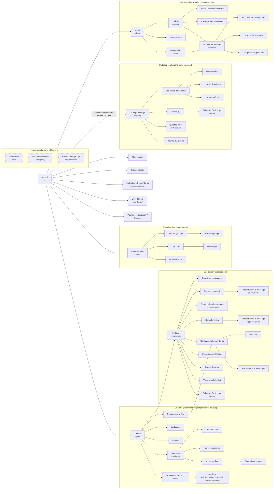

# Arborescence des écrans

Ce fichier décrit l'arbre des pages de l'application : qui est le parent de qui, et donc où mène « Retour ». **À tenir à jour à chaque nouvel écran** : une ligne dans le bon tableau, avec son parent, et le `back` de la page qui le dit dans le code.

## Vue d'ensemble

Chaque flèche va d'un écran vers ses enfants ; « Retour » la remonte. Les écrans en pointillés n'ont pas de « Retour » : on y arrive par un lien. Le schéma s'affiche sur GitHub et dans l'aperçu Markdown de VS Code ; les tableaux plus bas donnent les adresses et les panneaux.

## La règle du bouton « Retour »

Décidée par Julien le 18 novembre 2026.

- « Retour » remonte d'un cran dans cet arbre, vers le **parent logique** de l'écran. Ce n'est pas le retour du navigateur : un écran ouvert depuis l'accueil, un email ou un lien partagé remonte quand même à son parent.
- Chaque page déclare son parent dans `back` (`AdminScreen`, `ParticipantScreen`), et les actions qui ramènent après un enregistrement (« Valider », « Enregistrer ») vont au même parent.
- `useGoBack` (`app/composables/useGoBack.ts`) applique la règle avec `backMove` (`shared/utils/navigation.ts`, testé) : si la page précédente de l'historique est justement ce parent, le navigateur revient en arrière, pour ne pas empiler deux fois la même page ; sinon le parent s'ouvre.
- Les panneaux du bas (`UiSheet`) ne sont pas des écrans : ils se ferment, ils ne remontent pas. Ils sont indiqués sous l'écran qui les ouvre.
- Le retour du navigateur, lui, garde son comportement habituel.

## Accueil et compte

| Écran | Adresse | Parent (« Retour ») | Panneaux |
|---|---|---|---|
La barre du bas (« Accueil », « Créer », « Quoi de neuf », et « Admin » pour le super-admin) est sur l'accueil, « Quoi de neuf » et les pages des listes. « Créer » ouvre son panneau. « Une liste » mène à « Pour quelle occasion ? » (`/f/nouvelle?pour=liste`). « Un Secret Santa » change le panneau en son « Pour quelle occasion ? » (ticket 105) : une fête que j'organise mène au formulaire (`/admin/[fête]/editions/nouvelle`), « Une autre occasion » à `/f/nouvelle?pour=secret-santa`. Sans fête à moi, il mène droit à `/f/nouvelle?pour=secret-santa` ; à ma limite, à `/secret-santa/limite`. Le menu du compte s'ouvre sur mon icône, en haut à droite de chaque écran : « Mon compte », « Langue » (panneau du bas), « Se déconnecter ».

| Accueil, ou connexion sans session | `/` | — (barre du bas) | |

L'accueil (ticket 103) : l'en-tête d'une carte ouvre la fête (`/f/[fête]`) ; ses lignes ouvrent le Secret Santa (ma page par mon lien, sinon l'édition pour l'organisateur) et les listes (la mienne, celle d'un autre par son lien) ; « Nouvelle liste » ouvre `/listes/nouvelle`. « Préparer », dans « Bientôt », ouvre `/f/nouvelle?categorie=birthday&proche=[id]`. En bas, « Les fêtes passées » ouvre « Tirages passés » jusqu'au ticket 108, et « Ce que j'offre ailleurs » ouvre `/listes` jusqu'au ticket 106. Sans aucune fête, les deux cartes ouvrent « Pour quelle occasion ? ».
| Quoi de neuf (vide jusqu'au ticket 120) | `/quoi-de-neuf` | — (barre du bas) | |
| La limite de Secret Santa | `/secret-santa/limite` | Accueil | |
| Connexion | `/login` | — | |
| Le lien de connexion | `/login/[jeton]` | — | |
| Mon compte | `/compte` | Accueil | Prénom, nom, langue des emails, icône |
| Tirages passés | `/tirages-passes` | Accueil | |
| Rejoindre une fête (lien d'invitation) | `/rejoindre/[code]` | — | |

## Administration (super-admin)

| Écran | Adresse | Parent | Panneaux |
|---|---|---|---|
| Administration | `/admin` | Accueil | |
| Tous les groupes | `/admin/groupes` | Administration | |
| Nouveau groupe | `/admin/groupes/nouveau` | Tous les groupes (super-admin), sinon Accueil | |
| Comptes | `/admin/comptes` | Administration ; les comptes désactivés : Comptes | |
| Un compte | `/admin/comptes/[id]` | Comptes | Limite de Secret Santa, désactivation |
| Guide de style | `/admin/guide-de-style` | Administration | |

## Une fête (ses membres ; l'organisateur pour le reste)

Les anciennes adresses du groupe (`/admin/[groupe]`, `…/personnes`, `…/invitation`, `…/reglages`, `…/organisateurs`, `…/exclusions`, `…/journal`) mènent à celles de la fête (`partyPathOf`, `app/middleware/redirects.global.ts`). Les Secret Santa restent sous `/admin/[fête]/editions`.

| Écran | Adresse | Parent | Panneaux |
|---|---|---|---|
| Pour quelle occasion ? (puis « Qui est de la fête ? », `?etape=membres`) | `/f/nouvelle` | Accueil ; la seconde étape : la première | |
| La fête | `/f/[fête]` | Accueil | Quitter cette fête |
| Membres | `/f/[fête]/membres` | La fête | |
| Une personne | `/f/[fête]/membres/[id]` | Membres | Mon icône, exclusion |
| Nouvelle personne | `/f/[fête]/membres/nouvelle` | Membres | |
| Inviter par lien | `/f/[fête]/invitation` | Membres | Places, date limite |
| Ton mot sur la page | `/f/[fête]/invitation/mot` | Inviter par lien | |
| Exclusions | `/f/[fête]/exclusions` | Membres | Ajouter une exclusion |
| Journal | `/f/[fête]/journal` | La fête | À quoi sert-il ?, une alerte |
| Réglages de la fête | `/f/[fête]/reglages` | La fête | Catégorie, date, organisateur, suppression de la fête |
| (ancienne adresse) | `/f/[fête]/organisateurs` | mène aux Réglages de la fête | |

## Une édition (organisateur)

| Écran | Adresse | Parent | Panneaux |
|---|---|---|---|
| Un nouveau Secret Santa (« Le Secret Santa 2027 ») | `/admin/[fête]/editions/nouvelle` | La fête | |
| Une ligne du nouveau Secret Santa (gardée dans le formulaire, `useNewEditionDraft`) | `…/editions/nouvelle/[nom, date, budget, devine, mot, message]` | Le nouveau Secret Santa | |
| L'édition (Préparer, Réponses, Tirage fait, Fêter, Clôturée) | `/admin/[groupe]/editions/[id]` | La fête | Lancer le tirage, Le tirage a déjà été fait ?, Valider le tirage, Un souci ?, Envoi à une personne, Dévoiler, Date de la fête, Devine qui |
| Choisir les participants | `…/editions/[id]/ajouter` | L'édition | |
| Envoyer par email | `…/editions/[id]/emails` | L'édition | |
| Rappeler le jeu (À chacun, par email ; Au groupe) | `…/editions/[id]/rappel` (`?vers=groupe`) | L'édition | |
| Personnaliser le message | `…/editions/[id]/message?pour=` | L'édition, panneau d'envoi rouvert (`?envoyer=`) pour une personne ; Envoyer par email pour plusieurs ; Rappeler le jeu pour `rappel` et `groupe` | Langue du message |
| Réglages du Secret Santa (« Réglages de la fête » y mène aussi, pour le dernier de l'année) | `…/editions/[id]/reglages` | L'édition | Éviter la même personne, Devine qui, date, budget, pistes de cadeaux |
| Petit mot | `…/editions/[id]/mot` | Réglages du Secret Santa | |
| Mot ajouté aux messages | `…/editions/[id]/mot-messages` | Réglages du Secret Santa | |
| Exclusions de l'édition | `…/editions/[id]/exclusions` | L'édition | |
| Annuler le tirage | `…/editions/[id]/annuler` | L'édition | |
| Voir un seul résultat | `…/editions/[id]/voir-le-tirage` | L'édition | Le résultat de qui ? |
| Le palmarès de Devine qui (images) | `…/editions/[id]/palmares` | L'édition (la croix et « Voir tous les résultats ») | |
| (ancienne adresse) | `…/editions/[id]/participants/[pid]` | mène à l'édition, panneau d'envoi ouvert | |

## Un tirage (participant, par son lien personnel)

| Écran | Adresse | Parent | Panneaux |
|---|---|---|---|
| La page du tirage | `/p/[jeton]` | Accueil, seulement si ouverte depuis l'accueil ; sinon pas de « Retour » | Mon icône, À qui offres-tu un cadeau ? |
| Mes pistes de cadeaux | `/p/[jeton]/pistes` | La page du tirage | |
| Un texte des pistes | `/p/[jeton]/pistes/texte?texte=` (`lately`, `wouldHelp`, `avoid`) | Mes pistes de cadeaux | |
| Une idée précise (ajoutée, ou la `n`-ième) | `/p/[jeton]/pistes/idee` (`?n=`) | Mes pistes de cadeaux | |
| Une question de « Moi et les cadeaux » | `/p/[jeton]/pistes/question?n=` | Mes pistes de cadeaux | |
| Devine qui (pronostics, puis les réponses) | `/p/[jeton]/devine` | La page du tirage | Choisir un pronostic |
| Le palmarès de Devine qui (images) | `/p/[jeton]/devine/palmares` | Devine qui (la croix et « Voir tous les résultats ») | |
| Qui offre à qui (une fois le tirage dévoilé) | `/p/[jeton]/tirage` | La page du tirage | |
| Journal du groupe | `/p/[jeton]/journal` | La page du tirage | À quoi sert-il ?, une alerte |
| (ancienne adresse) | `/p/[jeton]/souhaits` | mène à Mes pistes de cadeaux | |

## Listes de cadeaux (README 22.19)

L'onglet « Listes » a disparu de la barre du bas (ticket 103) ; ses pages restent jusqu'au ticket 106.

| Écran | Adresse | Parent | Panneaux |
|---|---|---|---|
| Listes (l'onglet) | `/listes` | — (barre du bas) | |
| Nouvelle liste (crée le brouillon, puis ouvre la liste) | `/listes/nouvelle` | Listes | |
| La liste (le document) | `/listes/[id]` (`?nouvelle=1` à sa création) | Listes | L'icône de la liste, la date, quelqu'un d'autre, le lien d'une idée, supprimer une idée cochée |
| Personnaliser le message | `/listes/[id]/message` | La liste | |
| Ceux qui tiennent la liste | `/listes/[id]/teneurs` | La liste | |
| Supprimer la liste | `/listes/[id]/supprimer` | La liste | |
| L'invitation à tenir une liste | `/invitation/[jeton]` | Le lien de l'email | Sans session ; accepter connecte et ouvre la liste |
| Mes proches | `/famille` | Listes | |
| Un de mes proches | `/famille/[id]` (`?liste=&place=` depuis une liste) | La liste, sinon Mes proches | Son icône |
| Sa date de naissance, sa taille, sa ou ses pointures, son adresse email | `/famille/[id]/naissance`, `/taille`, `/pointure`, `/adresse` | Un de mes proches | |
| Supprimer de mes proches | `/famille/[id]/supprimer` (`?liste=` depuis une liste) | La liste, sinon sa fiche | |
| Un texte de ses goûts | `/famille/[id]/texte?texte=` | Une personne de ma famille | |
| Les questions de ses goûts | `/famille/[id]/question?n=` | Une personne de ma famille | |

### Une liste par son lien (lot 22), avec ou sans compte

| Écran | Adresse | Parent | Panneaux |
|---|---|---|---|
| La liste, par son lien | `/l/[jeton]` (`?cocher=` au retour du lien magique) | Listes si connecté ; sinon pas de « Retour » | Changer (seul, à plusieurs, au complet), Se joindre |
| Ton adresse, pour cocher | `/l/[jeton]/connexion?cocher=` | La liste, par son lien | |
| Les goûts d'une personne | `/l/[jeton]/gouts/[place]` | La liste, par son lien | |
