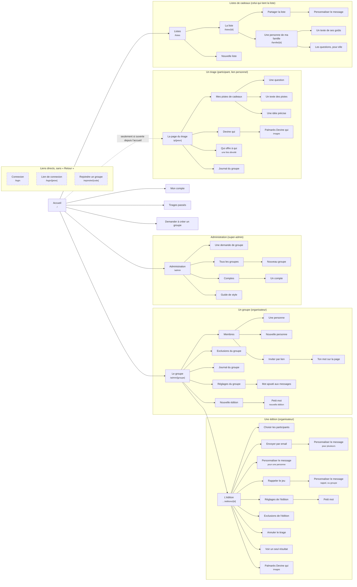

# Arborescence des écrans

Ce fichier décrit l'arbre des pages de l'application : qui est le parent de qui, et donc où mène « Retour ». **À tenir à jour à chaque nouvel écran** : une ligne dans le bon tableau, avec son parent, et le `back` de la page qui le dit dans le code.

## Vue d'ensemble

Chaque flèche va d'un écran vers ses enfants ; « Retour » la remonte. Les écrans en pointillés n'ont pas de « Retour » : on y arrive par un lien. Le schéma s'affiche sur GitHub et dans l'aperçu Markdown de VS Code ; les tableaux plus bas donnent les adresses et les panneaux.

## La règle du bouton « Retour »

Décidée par Julien le 18 novembre 2026.

- « Retour » remonte d'un cran dans cet arbre, vers le **parent logique** de l'écran. Ce n'est pas le retour du navigateur : un écran ouvert depuis l'accueil, un email ou un lien partagé remonte quand même à son parent.
- Chaque page déclare son parent dans `back` (`AdminScreen`, `ParticipantScreen`), et les actions qui ramènent après un enregistrement (« Valider », « Enregistrer ») vont au même parent.
- `useGoBack` (`app/composables/useGoBack.ts`) applique la règle avec `backMove` (`shared/utils/navigation.ts`, testé) : si la page précédente de l'historique est justement ce parent, le navigateur revient en arrière, pour ne pas empiler deux fois la même page ; sinon le parent s'ouvre.
- Les panneaux du bas (`UiSheet`) ne sont pas des écrans : ils se ferment, ils ne remontent pas. Ils sont indiqués sous l'écran qui les ouvre.
- Le retour du navigateur, lui, garde son comportement habituel.

## Accueil et compte

| Écran | Adresse | Parent (« Retour ») | Panneaux |
|---|---|---|---|
| Accueil, ou connexion sans session | `/` | — | Mon icône |
| Demander à créer un groupe | `/demande` | Accueil | |
| Connexion | `/login` | — | |
| Le lien de connexion | `/login/[jeton]` | — | |
| Mon compte | `/compte` | Accueil | Prénom, nom, langue des emails, icône |
| Tirages passés | `/tirages-passes` | Accueil | |
| Rejoindre un groupe (lien d'invitation) | `/rejoindre/[code]` | — | |

## Administration (super-admin)

| Écran | Adresse | Parent | Panneaux |
|---|---|---|---|
| Administration | `/admin` | Accueil | |
| Une demande de groupe (Refuser, Accepter) | `/admin/demandes/[id]` | Administration | |
| Tous les groupes | `/admin/groupes` | Administration | |
| Nouveau groupe | `/admin/groupes/nouveau` | Tous les groupes (super-admin), sinon Accueil | |
| Comptes | `/admin/comptes` | Administration ; les comptes désactivés : Comptes | |
| Un compte | `/admin/comptes/[id]` | Comptes | Quota, désactivation |
| Guide de style | `/admin/guide-de-style` | Administration | |

## Un groupe (organisateur)

| Écran | Adresse | Parent | Panneaux |
|---|---|---|---|
| Le groupe | `/admin/[groupe]` | Accueil | |
| Membres | `/admin/[groupe]/personnes` | Le groupe | |
| Une personne | `/admin/[groupe]/personnes/[id]` | Membres | Mon icône, exclusion |
| Nouvelle personne | `/admin/[groupe]/personnes/nouvelle` | Membres | |
| Inviter par lien | `/admin/[groupe]/invitation` | Membres | Places, date limite |
| Ton mot sur la page | `/admin/[groupe]/invitation/mot` | Inviter par lien | |
| Exclusions du groupe | `/admin/[groupe]/exclusions` | Le groupe | Ajouter une exclusion |
| Journal du groupe | `/admin/[groupe]/journal` | Le groupe | À quoi sert-il ?, une alerte |
| Réglages du groupe | `/admin/[groupe]/reglages` | Le groupe | Chaque réglage sauf le mot, organisateur, suppression du groupe |
| Mot ajouté aux messages | `/admin/[groupe]/reglages/mot` | Réglages du groupe | |
| (ancienne adresse) | `/admin/[groupe]/organisateurs` | mène aux Réglages du groupe | |

## Une édition (organisateur)

| Écran | Adresse | Parent | Panneaux |
|---|---|---|---|
| Nouvelle édition | `/admin/[groupe]/editions/nouvelle` | Le groupe | |
| Petit mot d'une nouvelle édition (gardé dans le formulaire, `useNewEditionDraft`) | `…/editions/nouvelle/mot` | Nouvelle édition | |
| L'édition (Préparer, Réponses, Tirage fait, Fêter, Clôturée) | `/admin/[groupe]/editions/[id]` | Le groupe | Lancer le tirage, Le tirage a déjà été fait ?, Valider le tirage, Un souci ?, Envoi à une personne, Dévoiler, Date de la fête, Devine qui |
| Choisir les participants | `…/editions/[id]/ajouter` | L'édition | |
| Envoyer par email | `…/editions/[id]/emails` | L'édition | |
| Rappeler le jeu (À chacun, par email ; Au groupe) | `…/editions/[id]/rappel` (`?vers=groupe`) | L'édition | |
| Personnaliser le message | `…/editions/[id]/message?pour=` | L'édition, panneau d'envoi rouvert (`?envoyer=`) pour une personne ; Envoyer par email pour plusieurs ; Rappeler le jeu pour `rappel` et `groupe` | Langue du message |
| Réglages de l'édition | `…/editions/[id]/reglages` | L'édition | Date, budget, Devine qui |
| Petit mot | `…/editions/[id]/mot` | Réglages de l'édition | |
| Exclusions de l'édition | `…/editions/[id]/exclusions` | L'édition | |
| Annuler le tirage | `…/editions/[id]/annuler` | L'édition | |
| Voir un seul résultat | `…/editions/[id]/voir-le-tirage` | L'édition | Le résultat de qui ? |
| Le palmarès de Devine qui (images) | `…/editions/[id]/palmares` | L'édition (la croix et « Voir tous les résultats ») | |
| (ancienne adresse) | `…/editions/[id]/participants/[pid]` | mène à l'édition, panneau d'envoi ouvert | |

## Un tirage (participant, par son lien personnel)

| Écran | Adresse | Parent | Panneaux |
|---|---|---|---|
| La page du tirage | `/p/[jeton]` | Accueil, seulement si ouverte depuis l'accueil ; sinon pas de « Retour » | Mon icône, À qui offres-tu un cadeau ? |
| Mes pistes de cadeaux | `/p/[jeton]/pistes` | La page du tirage | |
| Un texte des pistes | `/p/[jeton]/pistes/texte?texte=` (`lately`, `wouldHelp`, `avoid`) | Mes pistes de cadeaux | |
| Une idée précise (ajoutée, ou la `n`-ième) | `/p/[jeton]/pistes/idee` (`?n=`) | Mes pistes de cadeaux | |
| Une question de « Moi et les cadeaux » | `/p/[jeton]/pistes/question?n=` | Mes pistes de cadeaux | |
| Devine qui (pronostics, puis les réponses) | `/p/[jeton]/devine` | La page du tirage | Choisir un pronostic |
| Le palmarès de Devine qui (images) | `/p/[jeton]/devine/palmares` | Devine qui (la croix et « Voir tous les résultats ») | |
| Qui offre à qui (une fois le tirage dévoilé) | `/p/[jeton]/tirage` | La page du tirage | |
| Journal du groupe | `/p/[jeton]/journal` | La page du tirage | À quoi sert-il ?, une alerte |
| (ancienne adresse) | `/p/[jeton]/souhaits` | mène à Mes pistes de cadeaux | |

## Listes de cadeaux (README 22.19)

La barre du bas (« Tirages », « Listes ») est sur l'accueil et sur l'onglet « Listes ».

| Écran | Adresse | Parent | Panneaux |
|---|---|---|---|
| Listes (l'onglet) | `/listes` | — (barre du bas) | |
| Nouvelle liste (crée le brouillon, puis ouvre la liste) | `/listes/nouvelle` | Listes | |
| La liste (le document) | `/listes/[id]` (`?nouvelle=1` à sa création) | Listes | L'icône de la liste, la date, quelqu'un d'autre, le lien d'une idée, supprimer une idée cochée |
| Partager la liste | `/listes/[id]/partager` | La liste | |
| Personnaliser le message | `/listes/[id]/message` | Partager la liste | |
| Une personne de ma famille | `/famille/[id]` (`?liste=&place=` depuis une liste) | La liste, sinon Listes | Son icône, son prénom, sa date de naissance, sa taille, sa pointure |
| Un texte de ses goûts | `/famille/[id]/texte?texte=` | Une personne de ma famille | |
| Les questions de ses goûts | `/famille/[id]/question?n=` | Une personne de ma famille | |

### Une liste par son lien (lot 22), avec ou sans compte

| Écran | Adresse | Parent | Panneaux |
|---|---|---|---|
| La liste, par son lien | `/l/[jeton]` (`?cocher=` au retour du lien magique) | Listes si connecté ; sinon pas de « Retour » | Changer (seul, à plusieurs, au complet), Se joindre |
| Ton adresse, pour cocher | `/l/[jeton]/connexion?cocher=` | La liste, par son lien | |
| J'offre autre chose | `/l/[jeton]/hors-liste?pour=` | La liste, par son lien | |
| Les goûts d'une personne | `/l/[jeton]/gouts/[place]` | La liste, par son lien | |
